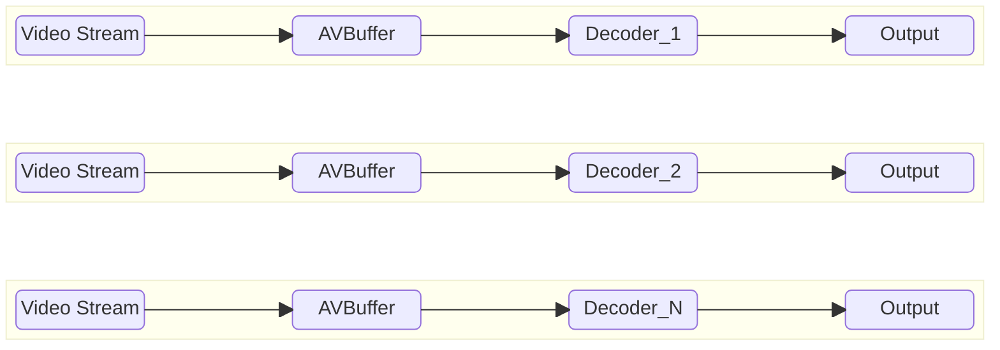

# VideoDecoder High Level Test Specification Document

## Table of Contents

- [Acronyms, Terms and Abbreviations](#acronyms-terms-and-abbreviations)
- [Introduction](#introduction)
- [Module Description](#module-description)
- [L2 Test Specification](#l2-test-specification)
- [L3 Test Specification](#l3-test-specification)
- [Test Stream specifications](#test-stream-specifications)

## Acronyms, Terms and Abbreviations

- `HAL`    - Hardware Abstraction Layer
- `API`    - Application Programming Interface
- `AIDL`   - Android Interface Definition Language
- `Caller` - Any user of the interface via the APIs
- `NA`     - Not Applicable
- `L2`     - Level 2 Testing
- `L3`     - Level 3 Testing
- `CB`     - Call-back function (suffix)
- `HDR`    - High Dynamic Range
- `SDR`    - Standard Dynamic Range
- `HEVC`   - High Efficiency Video Coding
- `RDK`    - Reference Design Kit
- `EOS`    - End of Stream
- `CSD`    - Codec Specific Data
- `NA`     - Not Applicable
- `Y`      - Yes

## Introduction

This document provides an overview of the testing requirements for the Video Decoder module. It outlines the scope of testing, objectives, testing levels and approaches, specific test requirements.

- Video Decoder Interface Definitions - [Video Decoder HAL](https://github.com/rdkcentral/rdk-halif-aidl/tree/v0.6/videodecoder/current/com/rdk/hal/videodecoder)

- Video Decoder Overview - [Video Decoder Overview](https://wiki.rdkcentral.com/display/RDKHAL/Video+Decoder)

## Module Description

The Video Decoder `HAL` service provides the interfaces for compressed audio to be passed to the vendor layer for decoding.  It may be passed secure buffers if it indicates support for secure audio processing.

The output of an audio decoder can take two routes:

1. **Non-tunnel mode** - Decoded `PCM` audio frames with metadata are sent back to the `RDK` media pipeline.
2. **Tunnel mode** - Video is passed directly to the vendor layer mixer.

## Test Stream specifications

- List of video test streams: [Video TestStreams](VideoDecoder_TestStreamsInfo.md)

- Each Test should refer [vts_l3_test_config.yaml](../../test_configuration/vts_l3_test_config.yaml) for the streams and information like `PTS`, frame sizes for the test.

### L2 Test Specification

|#|Test |Description|HAL APIs|
|-|-----|-----------|--------|
|1|Set and Get video Decoder Properties| - Get Supported Video Decoders `IVideoDecoderManager` class by calling `getVideoDecoderIds()`.   - Verify that the returned array of `IVideoDecoder.Id` objects is not null and contains valid IDs.   - Loop through each supported video decoder ID.   - Get Video Decoder Interface using `getVideoDecoder(videoDecoderId)`.   - Verify that the returned `IVideoDecoder` object is not null.   - Set and Verify Read-Write Properties:   &emsp; - For each read-write property in the `Property` enum   &emsp; - Set the property using `setProperty(property, propertyValue)`.   &emsp; - Retrieve the property value using `getProperty(property)`.   &emsp; - Verify that the retrieved value matches the set value.  &emsp; - Close the decoder using `close()`.    | - `IVideoDecoderManager:` getVideoDecoderIds, getVideoDecoder   - `IVideoDecoder:` open, getProperty, close   - `IVideoDecoderController:`  setProperty |
|2|Verify Set and Get with multiple video Decoder Properties| - Get Supported Video Decoders `IVideoDecoderManager` class by calling `getVideoDecoderIds()`.   - Verify that the returned array of `IVideoDecoder.Id` objects is not null and contains valid IDs.   - Check how many decoders are supported by counting the elements in the array  - Loop through each supported video decoder ID.   - Get Video Decoder Interface using `getVideoDecoder(videoDecoderId)`.   - Verify that the returned `IVideoDecoder` object is not null.   - Open and Set Properties for Multiple Decoders:   &emsp; -  For each supported video decoder ID:  &emsp;- Open the decoder using open().  &emsp;- For each read-write property in the `Property` enum   &emsp; - Set the property using `setProperty(property, propertyValue)`.   &emsp; - Retrieve the property value using `getProperty(property)`.   &emsp; - Verify that the retrieved value matches the set value.  -  Close the decoder using `close()`.   | - `IVideoDecoderManager:` getVideoDecoderIds, getVideoDecoder   - `IVideoDecoder:` open, getProperty, close   - `IVideoDecoderController:`  setProperty |
|3|Verify Decoder State Changes|- Get Supported Video Decoders using the `IVideoDecoderManager` class by calling `getVideoDecoderIds()`.   - Verify that the returned array of `IVideoDecoder.Id` objects is not null and contains valid IDs.   - Loop through each supported video decoder ID:  &emsp; - Get the Video Decoder Interface using `getVideoDecoder(videoDecoderId)`.   &emsp; - Verify that the returned `IVideoDecoder` object is not null.   &emsp; - Register event listeners using `registerEventListener`.   &emsp; - Open the decoder using `open()`.   &emsp; - Ensure each state(i.e. in the enum `State`) transitions(`open -> start -> flush -> stop -> close`) work as expected using `getState()`.   &emsp; - Validate event listener notifications using `onStateChanged`.    - Close the decoder using `close()`.   | - `IVideoDecoderManager:` getVideoDecoderIds, getVideoDecoder   - `IVideoDecoder:` open, getState, registerEventListener, unregisterEventListener, close   - `IVideoDecoderController` - start, stop, flush   |
|4|Verify Decoder State Changes with multiple video Decoder |- Get Supported Video Decoders using the `IVideoDecoderManager` class by calling `getVideoDecoderIds()`.   - Verify that the returned array of `IVideoDecoder.Id` objects is not null and contains valid IDs.   - Loop through each supported video decoder ID:  &emsp; - Get the Video Decoder Interface using `getVideoDecoder(videoDecoderId)`.   &emsp; - Verify that the returned `IVideoDecoder` object is not null.   &emsp; - Register event listeners using `registerEventListener`.   &emsp; - If platform supports multiple decoder, open all the instances of the decoders using `open()`.   &emsp; - Ensure each state(i.e. in the enum `State`) transitions(`open -> start -> flush -> stop -> close`) work as expected using `getState()`.   &emsp; - Validate event listener notifications using `onStateChanged`.    - Close the decoder using `close()`.   | - `IVideoDecoderManager:` getVideoDecoderIds, getVideoDecoder   - `IVideoDecoder:` open, getState, registerEventListener, unregisterEventListener, close   - `IVideoDecoderController` - start, stop, flush   |

### L3 Test Specification
### Prerequisites

#### AV Buffer

Video frames are supplied to the Video Decoder during testing, which necessitates a pre-validated AVBuffer module. Therefore, the AVBuffer must successfully pass VTS L1, L2, and L3 testing before being used in the Video Decoder tests

### Feature List

VTS L3 validates all the Video Decoder features in both sequential and concurrent decoding modes (if the platform supports multiple decoders) as represented below.

#### Sequential Decoding

The Sequential Decoding test evaluates each audio decoder individually, one after another, to ensure functional correctness across all supported features. This approach helps isolate issues and verify that every decoder instance performs as expected in a standalone environment.

#### Concurrent Decoding

The Concurrent Decoding test assesses the system's ability to handle multiple audio decoders operating simultaneously, each configured with different supported features. This test is designed to validate the robustness, resource management, and feature compatibility of the platform under concurrent load, and is applicable only if the platform supports multiple decoder instances.

The following table outlines the core features validated in the L3 test phase

|#|Testing Feature|Description|
|-|---------------|-----------|
|1|Tunnel/Non-Tunnel|Executes the decoder in tunnel mode. Based on stream format, the decoder chooses between tunnel and non-tunnel operation. In tunnel mode, the test validates only metrics and metadata.|
|2|Secure and Non-Secure|Initializes the decoder in secure mode, ensuring all buffer operations occur in secure memory|
|3|Error Streams|Verifies decoder behavior with error streams. Ensures appropriate events are raised and frame metadata is updated accurately|
|4|Codecs|Test the decoders ability to decode different codec Types supported as per the decoder capabilities. The decoder should be able to decode all the supported Codecs defined as per the capabilities and test all input streams defined in the configuration file|
|5|Discontinuity|This test verifies that the discontinuity signal is correctly passed to the decoder. The decoder must continue decoding subsequent frames without errors, and the metadata of the decoded frames should indicate that the discontinuity signal is enabled|
|6|EOS|Test the decoder's handling of an `eos` (end-of-stream) signal. The decoder should correctly decode all frames up to `eos` and update relevant metadata fields. It must ignore any buffers received after `eos` and resume normal decoding when restarted.|
|7|Flush without reset|Test the decoder's flush functionality. The decoder should discard any buffers already queued and resume normal decoding of subsequent frames|
|8|Flush with reset|Test the decoder’s flush functionality combined with reset. The decoder should discard all queued buffers and transition to the READY state. After restarting, the decoder should properly process incoming frames|
|9| Resolution| Test the decoders ability to decode different resolution supported. The decoder should be able to decode all the test streams with different resolution defined as per the configuration file|
|10| HDR Modes |Test the decoders ability to decode different HDR modes supported as per the decoder capabilities. The decoder should be able to decode all the supported HDR modes defined as per the capabilities and test all input streams defined in the configuration file |
|11| Frame Rates | Test the decoders ability to decode different frame rates supported. The decoder should be able to decode all the test streams with different frame rates defined as per the configuration file|
|12| GOP Structure |Test the decoders ability to decode different GOP structure in the following possibilities, Single I-frame or IDR frame,Single GOPs (closed), Multiple GOPs (open), Multiple GOPs (open and closed).|
|13| Low Latency mode | Test the decoder’s low latency functionality. The decoder should skip over B-Frames for gaming and Casting functions|
|14| Adaptive Bitrate Streaming | Test the decoders ability to decode ABR streams.|
|15|Concurrent decoding|If platform supports multiple decoders, test executes multiple decoders simultaneously, validating decoded outputs and their respective metrics.|

|#|Test|Tunnel|Secure|Error streams|CODEC|Discontinuity|EOS|Flush|Flush+Rest|Resolutions|HDR Modes|Frame Rates|GOP|Low Latency|Concurrency|
|-|----|------|------|-------------|----|-------------|---|-----|----------|-----------|---------|-----------|---|-----------|-----------|
|1|Decode_Sequential_NonTunnel_NonSecure|✘|✘|✘|✘|✘|✘|✘|✘|✘|✘|✘|✘|✘|✘|✘|
|2|Decode_Sequential_NonTunnel_NonSecure_Error|✘|✘|✔|✘|✘|✘|✘|✘|✘|✘|✘|✘|✘|✘|
|3|Decode_Sequential_NonTunnel_NonSecure_CODEC|✘|✘|✘|✔|✘|✘|✘|✘|✘|✘|✘|✘|✘|✘|
|4|Decode_Sequential_NonTunnel_NonSecure_Discontinuity|✘|✘|✘|✘|✔|✘|✘|✘|✘|✘|✘|✘|✘|✘|
|5|Decode_Sequential_NonTunnel_NonSecure_EOS|✘|✘|✘|✘|✘|✔|✘|✘|✘|✘|✘|✘|✘|✘|
|6|Decode_Sequential_NonTunnel_NonSecure_Flush|✘|✘|✘|✘|✘|✘|✔|✘|✘|✘|✘|✘|✘|✘|
|7|Decode_Sequential_NonTunnel_NonSecure_FlushReset|✘|✘|✘|✘|✘|✘|✘|✔|✘|✘|✘|✘|✘|✘|
|8|Decode_Sequential_NonTunnel_NonSecure_Resolutions|✘|✘|✘|✘|✘|✘|✘|✘|✔|✘|✘|✘|✘|✘|
|9|Decode_Sequential_NonTunnel_NonSecure_HDRModes|✘|✘|✘|✘|✘|✘|✘|✘|✘|✔|✘|✘|✘|✘|
|10|Decode_Sequential_NonTunnel_NonSecure_FrameRate|✘|✘|✘|✘|✘|✘|✘|✘|✘|✘|✔|✘|✘|✘|
|11|Decode_Sequential_NonTunnel_NonSecure_GOPStructure|✘|✘|✘|✘|✘|✘|✘|✘|✘|✘|✘|✔|✘|✘|
|12|Decode_Sequential_NonTunnel_NonSecure_LowLatency|✘|✘|✘|✘|✘|✘|✘|✘|✘|✘|✘|✘|✔|✘|
|13|Decode_Sequential_NonTunnel_Secure|✘|✔|✘|✘|✘|✘|✘|✘|✘|✘|✘|✘|✘|✘|
|14|Decode_Sequential_NonTunnel_Secure_Error|✘|✔|✔|✘|✘|✘|✘|✘|✘|✘|✘|✘|✘|✘|
|15|Decode_Sequential_NonTunnel_Secure_CODEC|✘|✔|✘|✔|✘|✘|✘|✘|✘|✘|✘|✘|✘|✘|
|16|Decode_Sequential_NonTunnel_Secure_Discontinuity|✘|✔|✘|✘|✔|✘|✘|✘|✘|✘|✘|✘|✘|✘|
|17|Decode_Sequential_NonTunnel_Secure_EOS|✘|✔|✘|✘|✘|✔|✘|✘|✘|✘|✘|✘|✘|✘|
|18|Decode_Sequential_NonTunnel_Secure_Flush|✘|✔|✘|✘|✘|✘|✔|✘|✘|✘|✘|✘|✘|✘|
|19|Decode_Sequential_NonTunnel_Secure_FlushReset|✘|✔|✘|✘|✘|✘|✘|✔|✘|✘|✘|✘|✘|✘|
|20|Decode_Sequential_NonTunnel_Secure_Resolutions|✘|✔|✘|✘|✘|✘|✘|✘|✔|✘|✘|✘|✘|✘|
|21|Decode_Sequential_NonTunnel_Secure_HDRModes|✘|✔|✘|✘|✘|✘|✘|✘|✘|✔|✘|✘|✘|✘|
|22|Decode_Sequential_NonTunnel_Secure_FrameRate|✘|✔|✘|✘|✘|✘|✘|✘|✘|✘|✔|✘|✘|✘|
|23|Decode_Sequential_NonTunnel_Secure_GOPStructure|✘|✔|✘|✘|✘|✘|✘|✘|✘|✘|✘|✔|✘|✘|
|24|Decode_Sequential_NonTunnel_Secure_LowLatency|✘|✔|✘|✘|✘|✘|✘|✘|✘|✘|✘|✘|✔|✘|
|25|Decode_Sequential_Tunnel_NonSecure|✔|✘|✘|✘|✘|✘|✘|✘|✘|✘|✘|✘|✘|✘|
|26|Decode_Sequential_Tunnel_NonSecure_Error|✔|✘|✔|✘|✘|✘|✘|✘|✘|✘|✘|✘|✘|✘|
|27|Decode_Sequential_Tunnel_NonSecure_CODEC|✔|✘|✘|✔|✘|✘|✘|✘|✘|✘|✘|✘|✘|✘|
|28|Decode_Sequential_Tunnel_NonSecure_Discontinuity|✔|✘|✘|✘|✔|✘|✘|✘|✘|✘|✘|✘|✘|✘|
|29|Decode_Sequential_Tunnel_NonSecure_EOS|✔|✘|✘|✘|✘|✔|✘|✘|✘|✘|✘|✘|✘|✘|
|30|Decode_Sequential_Tunnel_NonSecure_Flush|✔|✘|✘|✘|✘|✘|✔|✘|✘|✘|✘|✘|✘|✘|
|31|Decode_Sequential_Tunnel_NonSecure_FlushReset|✔|✘|✘|✘|✘|✘|✘|✔|✘|✘|✘|✘|✘|✘|
|32|Decode_Sequential_Tunnel_NonSecure_Resolutions|✔|✘|✘|✘|✘|✘|✘|✘|✔|✘|✘|✘|✘|✘|
|33|Decode_Sequential_Tunnel_NonSecure_HDRModes|✔|✘|✘|✘|✘|✘|✘|✘|✘|✔|✘|✘|✘|✘|
|34|Decode_Sequential_Tunnel_NonSecure_FrameRate|✔|✘|✘|✘|✘|✘|✘|✘|✘|✘|✔|✘|✘|✘|
|35|Decode_Sequential_Tunnel_NonSecure_GOPStructure|✔|✘|✘|✘|✘|✘|✘|✘|✘|✘|✘|✔|✘|✘|
|36|Decode_Sequential_Tunnel_NonSecure_LowLatency|✔|✘|✘|✘|✘|✘|✘|✘|✘|✘|✘|✘|✔|✘|
|37|Decode_Sequential_Tunnel_Secure|✔|✔|✘|✘|✘|✘|✘|✘|✘|✘|✘|✘|✘|✘|
|38|Decode_Sequential_Tunnel_Secure_Error|✔|✔|✔|✘|✘|✘|✘|✘|✘|✘|✘|✘|✘|✘|
|39|Decode_Sequential_Tunnel_Secure_CODEC|✔|✔|✘|✔|✘|✘|✘|✘|✘|✘|✘|✘|✘|✘|
|40|Decode_Sequential_Tunnel_Secure_Discontinuity|✔|✔|✘|✘|✔|✘|✘|✘|✘|✘|✘|✘|✘|✘|
|41|Decode_Sequential_Tunnel_Secure_EOS|✔|✔|✘|✘|✘|✔|✘|✘|✘|✘|✘|✘|✘|✘|
|42|Decode_Sequential_Tunnel_Secure_Flush|✔|✔|✘|✘|✘|✘|✔|✘|✘|✘|✘|✘|✘|✘|
|43|Decode_Sequential_Tunnel_Secure_FlushReset|✔|✔|✘|✘|✘|✘|✘|✔|✘|✘|✘|✘|✘|✘|
|44|Decode_Sequential_Tunnel_Secure_Resolutions|✔|✔|✘|✘|✘|✘|✘|✘|✔|✘|✘|✘|✘|✘|
|45|Decode_Sequential_Tunnel_Secure_HDRModes|✔|✔|✘|✘|✘|✘|✘|✘|✘|✔|✘|✘|✘|✘|
|46|Decode_Sequential_Tunnel_Secure_FrameRate|✔|✔|✘|✘|✘|✘|✘|✘|✘|✘|✔|✘|✘|✘|
|47|Decode_Sequential_Tunnel_Secure_GOPStructure|✔|✔|✘|✘|✘|✘|✘|✘|✘|✘|✘|✔|✘|✘|
|48|Decode_Sequential_Tunnel_Secure_LowLatency|✔|✔|✘|✘|✘|✘|✘|✘|✘|✘|✘|✘|✔|✘|
|49|Decode_Concurrent_NonTunnel_NonSecure|✘|✘|✘|✘|✘|✘|✘|✘|✔|✘|✘|✘|✘|✔|
|50|Decode_Concurrent_NonTunnel_NonSecure_Error|✘|✘|✔|✘|✘|✘|✘|✘|✘|✘|✘|✘|✘|✔|
|51|Decode_Concurrent_NonTunnel_NonSecure_CODEC|✘|✘|✘|✔|✘|✘|✘|✘|✘|✘|✘|✘|✘|✔|
|52|Decode_Concurrent_NonTunnel_NonSecure_Discontinuity|✘|✘|✘|✘|✘|✘|✘|✘|✔|✘|✘|✘|✘|✔|
|53|Decode_Concurrent_NonTunnel_NonSecure_EOS|✘|✘|✘|✘|✘|✔|✘|✘|✘|✘|✘|✘|✘|✔|
|54|Decode_Concurrent_NonTunnel_NonSecure_Flush|✘|✘|✘|✘|✘|✘|✔|✘|✘|✘|✘|✘|✘|✔|
|55|Decode_Concurrent_NonTunnel_NonSecure_FlushReset|✘|✘|✘|✘|✘|✘|✘|✔|✘|✘|✘|✘|✘|✔|
|56|Decode_Concurrent_NonTunnel_NonSecure_Resolutions|✘|✘|✘|✘|✘|✘|✘|✘|✔|✘|✘|✘|✘|✔|
|57|Decode_Concurrent_NonTunnel_NonSecure_HDRModes|✘|✘|✘|✘|✘|✘|✘|✘|✘|✔|✘|✘|✘|✔|
|58|Decode_Concurrent_NonTunnel_NonSecure_FrameRate|✘|✘|✘|✘|✘|✘|✘|✘|✘|✘|✔|✘|✘|✔|
|59|Decode_Concurrent_NonTunnel_NonSecure_GOPStructure|✘|✘|✘|✘|✘|✘|✘|✘|✘|✘|✘|✔|✘|✔
|60|Decode_Concurrent_NonTunnel_NonSecure_LowLatency|✘|✘|✘|✘|✘|✘|✘|✘|✘|✘|✘|✘|✔|✔|
|61|Decode_Concurrent_NonTunnel_Secure|✘|✔|✘|✘|✘|✘|✘|✘|✔|✘|✘|✘|✘|✔|
|62|Decode_Concurrent_NonTunnel_Secure_Error|✘|✔|✔|✘|✘|✘|✘|✘|✔|✘|✘|✘|✘|✔|
|63|Decode_Concurrent_NonTunnel_Secure_CODEC|✘|✔|✘|✔|✘|✘|✘|✘|✔|✘|✘|✘|✘|✔|
|64|Decode_Concurrent_NonTunnel_Secure_Discontinuity|✘|✔|✘|✘|✔|✘|✘|✘|✔|✘|✘|✘|✘|✔|
|65|Decode_Concurrent_NonTunnel_Secure_EOS|✘|✔|✘|✘|✘|✔|✘|✘|✔|✘|✘|✘|✘|✔|
|66|Decode_Concurrent_NonTunnel_Secure_Flush|✘|✔|✘|✘|✘|✘|✔|✘|✔|✘|✘|✘|✘|✔|
|67|Decode_Concurrent_NonTunnel_Secure_FlushReset|✘|✔|✘|✘|✘|✘|✘|✔|✔|✘|✘|✘|✘|✔|
|68|Decode_Concurrent_NonTunnel_Secure_Resolutions|✘|✔|✘|✘|✘|✘|✘|✘|✔|✘|✘|✘|✘|✔|
|69|Decode_Concurrent_NonTunnel_Secure_HDRModes|✘|✔|✘|✘|✘|✘|✘|✘|✘|✔|✘|✘|✘|✔|
|70|Decode_Concurrent_NonTunnel_Secure_FrameRate|✘|✔|✘|✘|✘|✘|✘|✘|✘|✘|✔|✘|✘|✔|
|71|Decode_Concurrent_NonTunnel_Secure_GOPStructure|✘|✔|✘|✘|✘|✘|✘|✘|✘|✘|✘|✔|✘|✔
|72|Decode_Concurrent_NonTunnel_Secure_LowLatency|✘|✔|✘|✘|✘|✘|✘|✘|✘|✘|✘|✘|✔|✔|
|73|Decode_Concurrent_Tunnel_NonSecure|✔|✘|✘|✘|✘|✘|✘|✘|✔|✘|✘|✘|✘|✔|
|74|Decode_Concurrent_Tunnel_NonSecure_Error|✔|✘|✔|✘|✘|✘|✘|✘|✔|✘|✘|✘|✘|✔|
|75|Decode_Concurrent_Tunnel_NonSecure_CODEC|✔|✘|✘|✔|✘|✘|✘|✘|✔|✘|✘|✘|✘|✔|
|76|Decode_Concurrent_Tunnel_NonSecure_Discontinuity|✔|✘|✘|✘|✔|✘|✘|✘|✔|✘|✘|✘|✘|✔|
|77|Decode_Concurrent_Tunnel_NonSecure_EOS|✔|✘|✘|✘|✘|✔|✘|✘|✔|✘|✘|✘|✘|✔|
|78|Decode_Concurrent_Tunnel_NonSecure_Flush|✔|✘|✘|✘|✘|✘|✔|✘|✔|✘|✘|✘|✘|✔|
|79|Decode_Concurrent_Tunnel_NonSecure_FlushReset|✔|✘|✘|✘|✘|✘|✘|✔|✔|✘|✘|✘|✘|✔|
|80|Decode_Concurrent_Tunnel_NonSecure_Resolutions|✔|✘|✘|✘|✘|✘|✘|✘|✔|✘|✘|✘|✘|✔|
|81|Decode_Concurrent_Tunnel_NonSecure_HDRModes|✔|✘|✘|✘|✘|✘|✘|✘|✘|✔|✘|✘|✘|✔|
|82|Decode_Concurrent_Tunnel_NonSecure_FrameRate|✔|✘|✘|✘|✘|✘|✘|✘|✘|✘|✔|✘|✘|✔|
|83|Decode_Concurrent_Tunnel_NonSecure_GOPStructure|✔|✘|✘|✘|✘|✘|✘|✘|✘|✘|✘|✔|✘|✔
|84|Decode_Concurrent_Tunnel_NonSecure_LowLatency|✔|✘|✘|✘|✘|✘|✘|✘|✘|✘|✘|✘|✔|✔|
|85|Decode_Concurrent_Tunnel_Secure|✔|✔|✘|✘|✘|✘|✘|✘|✔|✘|✘|✘|✘|✔|
|86|Decode_Concurrent_Tunnel_Secure_Error|✔|✔|✔|✘|✘|✘|✘|✘|✔|✘|✘|✘|✘|✔|
|87|Decode_Concurrent_Tunnel_Secure_CODEC|✔|✔|✘|✔|✘|✘|✘|✘|✔|✘|✘|✘|✘|✔|
|88|Decode_Concurrent_Tunnel_Secure_Discontinuity|✔|✔|✘|✘|✔|✘|✘|✘|✔|✘|✘|✘|✘|✔|
|89|Decode_Concurrent_Tunnel_Secure_EOS|✔|✔|✘|✘|✘|✔|✘|✘|✔|✘|✘|✘|✘|✔|
|90|Decode_Concurrent_Tunnel_Secure_Flush|✔|✔|✘|✘|✘|✘|✔|✘|✔|✘|✘|✘|✘|✔|
|91|Decode_Concurrent_Tunnel_Secure_FlushReset|✔|✔|✘|✘|✘|✘|✘|✔|✔|✘|✘|✘|✘|✔|
|92|Decode_Concurrent_Tunnel_Secure_Resolutions|✔|✔|✘|✘|✘|✘|✘|✘|✔|✘|✘|✘|✘|✔|
|93|Decode_Concurrent_Tunnel_Secure_HDRModes|✔|✔|✘|✘|✘|✘|✘|✘|✘|✔|✘|✘|✘|✔|
|94|Decode_Concurrent_Tunnel_Secure_FrameRate|✔|✔|✘|✘|✘|✘|✘|✘|✘|✘|✔|✘|✘|✔|
|95|Decode_Concurrent_Tunnel_Secure_GOPStructure|✔|✔|✘|✘|✘|✘|✘|✘|✘|✘|✘|✔|✘|✔
|96|Decode_Concurrent_Tunnel_Secure_LowLatency|✔|✔|✘|✘|✘|✘|✘|✘|✘|✘|✘|✘|✔|✔|

